---

# 💼 Portfólio Profissional — Lucas Sivolella 👨‍💻

<table>
  <tr>
    <td width="800px">
      <div align="justify">
        Website de <b>portfólio profissional</b>, bilíngue (<b>PT/EN</b>) e com <b>temas claro e escuro</b>, criado para apresentar minha trajetória, habilidades, projetos e formas de contato de maneira moderna e acessível.
        <br><br>
        Desenvolvido com <b>React, TypeScript, Vite e Tailwind CSS</b>, o conteúdo (experiências, formação, habilidades e projetos) é mantido em arquivos de dados tipados. Tanto os <i>textos</i> quanto as <i>cores</i> são acessados por <b>rótulos</b>, o que permite alternar idioma e tema sem alterar a estrutura das páginas.
      </div>
    </td>
    <td>
      <div>
        
      </div>
    </td>
  </tr>
</table>

---

## 🚧 Status do Projeto


---

## 📚 Índice
- [Links Úteis](#-links-úteis)
- [Sobre o Projeto](#-sobre-o-projeto)
- [Funcionalidades Principais](#-funcionalidades-principais)
- [Tecnologias Utilizadas](#-tecnologias-utilizadas)
- [Arquitetura](#-arquitetura)
- [Instalação e Execução](#-instalação-e-execução)
  - [Pré-requisitos](#pré-requisitos)
  - [Variáveis de Ambiente](#-variáveis-de-ambiente)
  - [Instalação de Dependências](#-instalação-de-dependências)
  - [Como Executar a Aplicação](#-como-executar-a-aplicação)
- [Deploy](#-deploy)
- [Estrutura de Pastas](#-estrutura-de-pastas)
- [Demonstração](#-demonstração)
- [Testes](#-testes)
- [Documentações utilizadas](#-documentações-utilizadas)
- [Autores](#-autores)
- [Contribuição](#-contribuição)
- [Agradecimentos](#-agradecimentos)
- [Licença](#-licença)

---

## 🔗 Links Úteis
* 🌐 **Demo Online:** [lucas-sivolella.vercel.app](https://lucas-sivolella.vercel.app)
* 📦 **Repositório:** [github.com/lsivolella/portfolio](https://github.com/lsivolella/portfolio)

---

## 📝 Sobre o Projeto

Sou **Lucas Sivolella**, desenvolvedor de software com mais de 5 anos de experiência trabalhando com C# e Unity para equipes internacionais. Meu foco atual é o desenvolvimento de sistemas corporativos web e mobile.

Este portfólio é a minha apresentação profissional em um só lugar: quem sou, o que já construí e como falar comigo.

- **Por que existe:** reunir minha experiência, habilidades e projetos de forma clara, em português e em inglês, para recrutadores e equipes de diferentes países.
- **Qual problema resolve:** um currículo em PDF é estático e logo fica desatualizado. Aqui, experiências, formação, habilidades e projetos vivem em arquivos de dados e são atualizados em um só lugar.
- **O que entrega:** uma visão rápida do meu perfil (Home), a linha do tempo dos meus projetos pessoais e profissionais (Projetos) e canais diretos de contato, incluindo um formulário (Contato).
- **Onde pode ser utilizado:** processos seletivos, networking e como cartão de visitas em perfis profissionais.

---

## ✨ Funcionalidades Principais

> 🚧 Projeto em construção. Itens marcados com ✅ estão concluídos; os demais estão planejados.

- ✅ **Roteamento por páginas:** navegação entre Home, Projetos e Contato com React Router.
- 🎨 **Temas claro e escuro:** cores definidas por rótulos semânticos em um único arquivo, com preferência salva no navegador.
- 🌐 **Internacionalização (PT/EN):** textos acessados por rótulos, com alternância de idioma.
- 🏠 **Home:** apresentação pessoal, habilidades, experiências profissionais, formação acadêmica e idiomas, em seções numeradas.
- 🗂️ **Projetos:** linha do tempo do mais antigo ao mais recente, com projetos pessoais (repositório no GitHub) e profissionais (link para página do projeto), cada um com descrição, tecnologias e imagem/GIF.
- 📨 **Contato:** ícones clicáveis (e-mail, WhatsApp, LinkedIn, GitHub) e formulário com nome, e-mail e mensagem, validado e enviado por e-mail via EmailJS.
- 📱 **Design responsivo:** layout adaptado para desktop, tablet e celular.

---

## 🛠 Tecnologias Utilizadas

### 💻 Front-end

* **Biblioteca:** React 19
* **Linguagem:** TypeScript 6
* **Build Tool:** Vite 8
* **Estilização:** Tailwind CSS 4 (via plugin `@tailwindcss/vite`)
* **Roteamento:** React Router 7 (`react-router-dom`)
* **Gerenciamento de Estado:** Context API (tema e idioma)
* **Formulário e validação:** React Hook Form *(planejado)*
* **Envio de e-mail:** EmailJS *(planejado)*
* **Ícones:** react-icons *(planejado)*
* **Qualidade de código:** ESLint com `typescript-eslint`, `eslint-plugin-react-hooks` e `eslint-plugin-react-refresh`

### 🖥️ Back-end

* Não há back-end próprio. O envio do formulário de contato é feito diretamente do front-end pelo **EmailJS**.

### ⚙️ Infraestrutura & DevOps

* **Hospedagem:** Vercel
* **Versionamento:** Git e GitHub

---

## 🏗 Arquitetura

O projeto é uma **Single Page Application (SPA)** em React, sem back-end, organizada por páginas e por sistemas transversais.

**Principais decisões:**

- **Conteúdo orientado a dados:** experiências, formação, habilidades e projetos ficam em arquivos tipados em `src/data/`. As páginas apenas renderizam esses dados; atualizar o currículo significa editar um arquivo pequeno.
- **Textos e cores por rótulos:** `i18n/` (PT/EN) e `theme/` (claro/escuro) seguem o mesmo padrão: um conjunto tipado de rótulos, com um valor por idioma/tema. O TypeScript aponta qualquer rótulo ausente em uma das variantes.
- **Componentes por escopo:** o que pertence a uma única página fica na pasta da própria página; o que é compartilhado vai para `components/layout` (estrutura do site) ou `components/ui` (blocos genéricos).
- **Direção de dependência:** páginas importam de `components/`, `data/`, `theme/` e `i18n/`, nunca o contrário, e nunca importam de outras páginas.

**Rotas:**

| Rota | Página | Conteúdo |
| :--- | :--- | :--- |
| `/` | Home | Sobre mim, habilidades, experiências, formação e idiomas |
| `/projects` | Projetos | Linha do tempo de projetos |
| `/contact` | Contato | Ícones de contato e formulário |

### Diagramas

> 🚧 *Diagramas de arquitetura: atualização em breve.*

---

## 🔧 Instalação e Execução

### Pré-requisitos

* **Node.js:** versão 22 (LTS) ou superior
* **Gerenciador de pacotes:** npm
* **Git**

---

### 🔑 Variáveis de Ambiente

O formulário de contato utilizará o EmailJS. Crie um arquivo **`.env.local`** na raiz do projeto (ele não é versionado) com as variáveis abaixo. O prefixo `VITE_` é obrigatório para que o Vite as exponha ao código do cliente.

| Variável | Descrição |
| :--- | :--- |
| `VITE_EMAILJS_SERVICE_ID` | ID do serviço configurado no EmailJS |
| `VITE_EMAILJS_TEMPLATE_ID` | ID do template de e-mail |
| `VITE_EMAILJS_PUBLIC_KEY` | Chave pública do EmailJS |

> 🚧 *As variáveis serão confirmadas quando o formulário de contato for implementado.*

---

### 📦 Instalação de Dependências

```bash
git clone https://github.com/lsivolella/portfolio.git
cd portfolio
npm install
```

---

### ⚡ Como Executar a Aplicação

```bash
# Servidor de desenvolvimento (http://localhost:5173)
npm run dev

# Verificação de tipos e build de produção (gera a pasta /dist)
npm run build

# Pré-visualização do build de produção
npm run preview

# Análise estática com ESLint
npm run lint
```

---

## 🚀 Deploy

O site é publicado gratuitamente na **Vercel**, com deploy automático a cada push na branch principal.

1. Importe o repositório na Vercel (framework detectado automaticamente: **Vite**).
2. Configure as variáveis de ambiente `VITE_EMAILJS_*` em *Project Settings > Environment Variables*.
3. Como o projeto é uma SPA, o arquivo `vercel.json` na raiz define um *rewrite* para `index.html`, para que rotas como `/projects` funcionem em acesso direto:

```json
{
  "rewrites": [{ "source": "/(.*)", "destination": "/index.html" }]
}
```

🌐 **Site publicado:** [lucas-sivolella.vercel.app](https://lucas-sivolella.vercel.app)

---

## 📂 Estrutura de Pastas

```
.
├── README.md                    # 📘 Documentação principal do projeto.
├── index.html                   # 🌐 Ponto de entrada HTML do Vite.
├── package.json                 # 📦 Dependências e scripts.
├── vite.config.ts               # ⚙️ Configuração do Vite (plugins e alias @/).
├── tsconfig*.json               # 🛠️ Configuração do TypeScript.
├── eslint.config.js             # ✨ Regras do ESLint.
├── /public                      # 📂 Arquivos estáticos com URL fixa.
└── /src
    ├── main.tsx                 # 🚪 Ponto de entrada React.
    ├── App.tsx                  # 🧩 Providers (tema, idioma) e roteador.
    ├── router.tsx               # 🧭 Tabela de rotas.
    ├── index.css                # 🎨 Tailwind e mapeamento dos rótulos de cor.
    ├── /pages                   # 📄 Uma pasta por página
    │   ├── /Home                #    HomePage + components (Skills, Experience, Education, Languages)
    │   ├── /Projects            #    ProjectsPage + components
    │   └── /Contact             #    ContactPage + components (ContactForm, links)
    ├── /components
    │   ├── /layout              # 🧱 Estrutura do site (Layout, Header, Footer).
    │   └── /ui                  # 🧩 Blocos genéricos reutilizáveis.
    ├── /theme                   # 🌗 Cores por rótulo, provider e hook de tema.
    ├── /i18n                    # 🌐 Dicionários PT/EN, provider e hook de tradução.
    ├── /data                    # 🗃️ Conteúdo do currículo e projetos (tipado).
    ├── /lib                     # 🛠️ Funções utilitárias puras (ex.: formatação de datas).
    └── /assets                  # 🖼️ Imagens importadas pelo código.
```

---

## 🎥 Demonstração

> 🚧 *Capturas de tela e GIFs das páginas (modo claro e escuro, PT e EN, desktop e celular): atualização em breve.*

---

## 🧪 Testes

O escopo atual do laboratório não inclui testes automatizados. A qualidade do código é verificada por:

```bash
npm run lint    # análise estática (ESLint)
npm run build   # verificação de tipos (tsc) + build
```

---

## 🔗 Documentações utilizadas

* 📖 [React](https://react.dev/)
* 📖 [Vite](https://vite.dev/)
* 📖 [TypeScript](https://www.typescriptlang.org/docs/)
* 📖 [Tailwind CSS](https://tailwindcss.com/docs)
* 📖 [React Router](https://reactrouter.com/)
* 📖 [React Hook Form](https://react-hook-form.com/)
* 📖 [EmailJS](https://www.emailjs.com/docs/)
* 📖 [Vercel](https://vercel.com/docs)

---

## 👥 Autores

| 👤 Nome | :octocat: GitHub | 💼 LinkedIn | 📤 Gmail |
|---------|------------------|-------------|----------|
| Lucas Sivolella | [lsivolella](https://github.com/lsivolella) | [lucassivolella](https://www.linkedin.com/in/lucassivolella) | [lucassivolella@gmail.com](mailto:lucassivolella@gmail.com) |

---

## 🤝 Contribuição

Este é um projeto acadêmico e pessoal, portanto não recebe contribuições de código. Sugestões e correções são bem-vindas por meio de uma *issue* no repositório.

---

## 🙏 Agradecimentos

* [**Engenharia de Software PUC Minas**](https://www.instagram.com/engsoftwarepucminas/) - Pelo apoio institucional e estrutura acadêmica.
* [**Prof. Dr. João Paulo Aramuni**](https://github.com/joaopauloaramuni) - Pela proposta do laboratório e pelo template de documentação.
* [**Luca Azalim**](https://azal.im/) - Pelo portfólio utilizado como referência de estrutura e navegação.

---

## 📄 Licença

> 🚧 *Licença a definir.*

---
